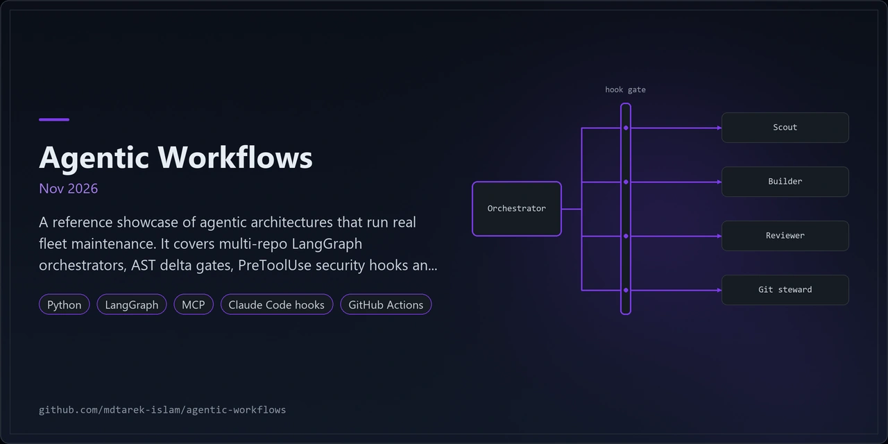
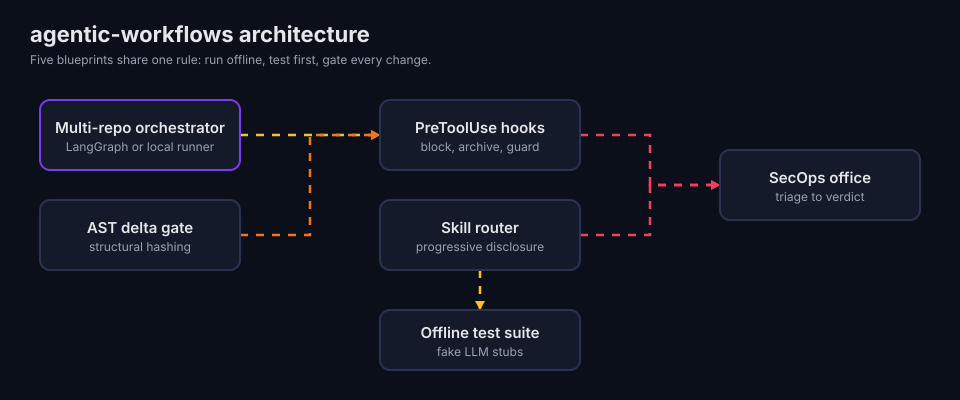
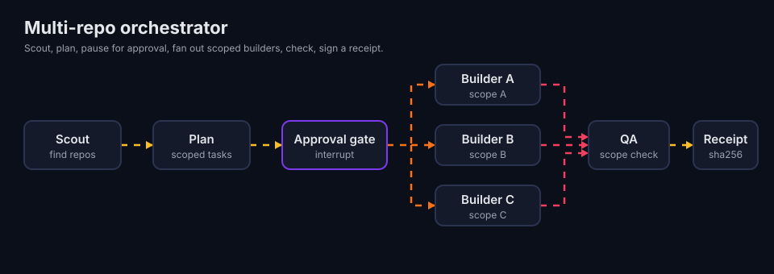
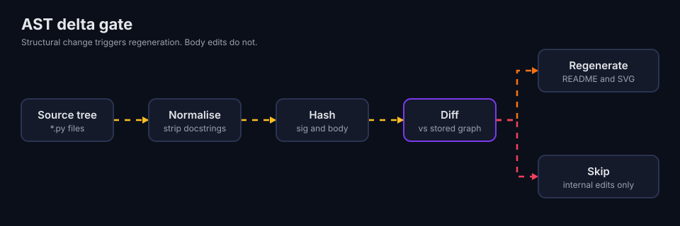
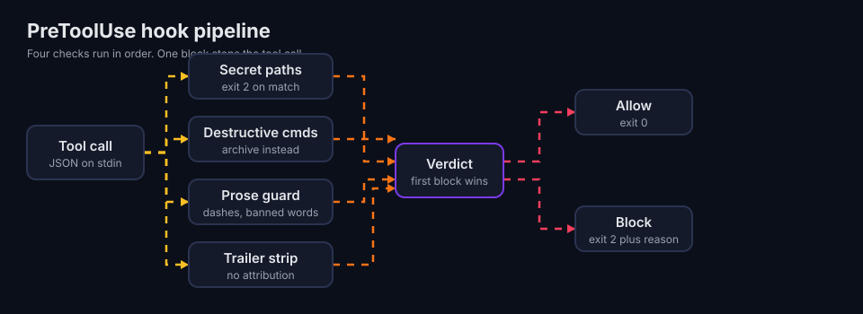
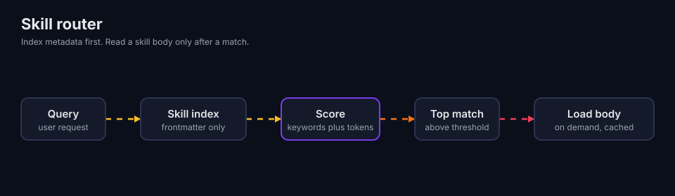
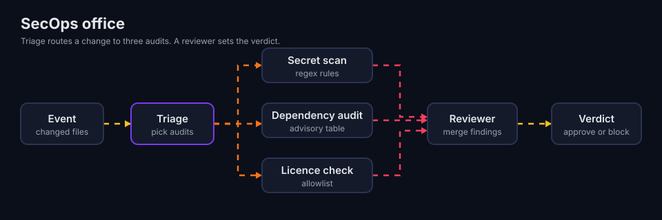
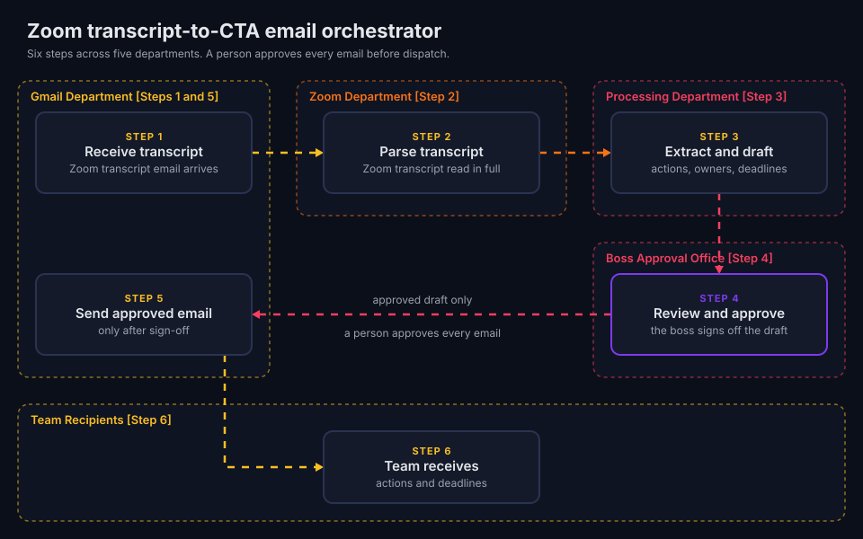
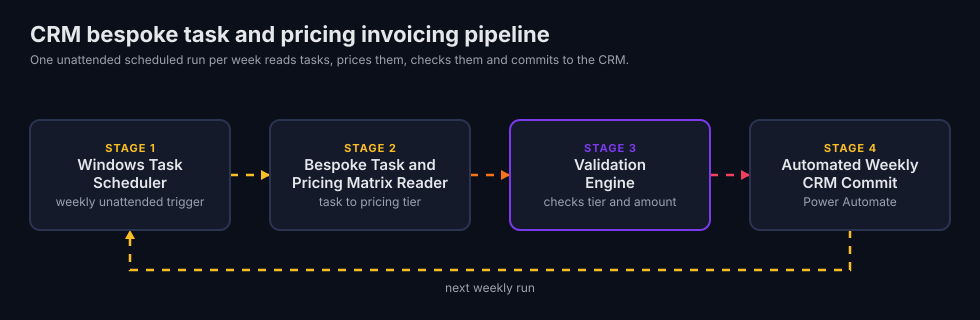
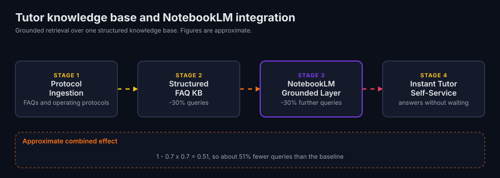

<p align="center"></p>

# agentic-workflows

## 1. Overview

This repository holds open reference blueprints for automated repository maintenance. They cover CI/CD governance, deterministic AST regression auditing and documentation synchronisation. Each blueprint is a small Python module with tests. Everything runs offline with fake model stubs, so you need no API key.

The blueprints mirror the governance that maintains a fleet of 16 repositories. That setup uses LangGraph, MCP servers, guard hooks and scoped agent roles. The code here is a generic, offline version of those patterns.

The repository also documents three architectural case studies from live internal deployments. They show agentic workflows in day-to-day business operations. The case studies ship as documents and diagrams only, with no source code.

Timeline: Dec 2025 to Nov 2026.

### Where agentic workflows fit

In business operations, agentic workflows take on repeatable admin work between existing systems:

| Area | Typical job | Case study |
|---|---|---|
| Inbox triage | Read incoming mail, pull out the actions, draft the reply | [Zoom transcript-to-CTA email orchestrator](docs/case-studies/zoom-cta-orchestrator.md) |
| Back-office reconciliation | Match records to a reference table and post totals | [CRM bespoke task and pricing invoicing pipeline](docs/case-studies/crm-invoicing-pipeline.md) |
| Knowledge support | Answer staff questions from approved sources | [Tutor knowledge base and NotebookLM integration](docs/case-studies/tutor-notebooklm-kb.md) |

In repository maintenance, the same approach handles checks that people tend to skip. Hooks block unsafe commands. AST graphs flag documentation that no longer matches the code. Receipts record what each run touched.

One principle holds across both settings: a person approves anything that leaves the system. The email orchestrator waits for the boss. The maintenance setup waits for an explicit approval token before any git push.

## 2. Architecture



### Open maintenance blueprints

| Blueprint | Diagram |
|---|---|
| Multi-repo orchestrator |  |
| AST delta gate |  |
| PreToolUse hooks |  |
| Skill router |  |
| SecOps office |  |

### Case studies from live internal deployments



Five department zones pass a transcript from inbox to team. The Boss Approval Office sits between the draft and the send. Read the [full case study](docs/case-studies/zoom-cta-orchestrator.md).



A scheduled run reads tasks, prices them, validates them and commits them to the CRM. Read the [full case study](docs/case-studies/crm-invoicing-pipeline.md).



Protocols become a structured knowledge base, and NotebookLM answers from it. Read the [full case study](docs/case-studies/tutor-notebooklm-kb.md).

Design tokens live in [DESIGN.md](DESIGN.md).

## 3. Features

### Open maintenance blueprints

1. **Orchestrator**: scout, plan, approval interrupt, parallel scoped builders through `Send`, QA, signed receipt. Falls back to a local runner when LangGraph is absent.
2. **AST delta gate**: hashes normalised syntax trees. Docstrings, comments and formatting leave a hash unchanged. Only structural change triggers documentation regeneration.
3. **Hook pipeline**: blocks secret paths, deletions, prose rule breaks and attribution trailers. Ships in shell and Python.
4. **Skill router**: indexes frontmatter only. Scores by keywords and token overlap. Loads a body on demand.
5. **SecOps office**: triage, secret scan, dependency audit, licence check and a reviewer verdict.

### Case studies (documentation only)

1. **Autonomous Zoom Transcript-to-CTA Email Orchestrator** (Actively maintained). Watches a work inbox for weekly Zoom transcripts. Drafts calls to action, owners and deadlines, then holds the draft for human review.
2. **Automated CRM Bespoke Task and Pricing Invoicing Pipeline** (Actively maintained). Reads the week's bespoke tasks. Matches each task to a pricing tier and calculates the amount owed.
3. **Conversational Tutor Knowledge Base and NotebookLM Integration** (Actively maintained). A grounded retrieval and self-service knowledge architecture, not a multi-agent loop. Collects tutor FAQs and protocols into one knowledge base with NotebookLM on top.

### Production evaluation and verification

| Workflow | Why it was needed (baseline manual bottleneck) | How it is evaluated in production | Measured outcome |
|---|---|---|---|
| Zoom transcript-to-CTA email | Someone wrote each weekly follow-up email by hand. | Schema validation pass on each draft. Reviewer checks action-item extraction recall against the transcript. Human-in-the-loop edit distance between draft and sent email. | About 2 hours a week saved. A person approves each email before dispatch. |
| CRM invoicing | A person summed invoices and typed CRM entries each week. | Pricing-tier reconciliation against the matrix each week. | About 1 hour a week saved. One unattended weekly run. |
| Tutor knowledge base | Tutors waited on course leaders and admin staff for routine answers. | Query deflection rate from course leader inbox counts. | Roughly 30% fewer queries, then roughly 30% fewer again. About 51% fewer overall, since 1 - 0.7 x 0.7 = 0.51. |
| Repository maintenance (these blueprints) | README, graph and release checks across 16 fleet repositories ran by hand. | The workspace runs 13 guard hooks. They include a pre-push main-only gate, secret-zone leak blocking, venv enforcement and a prose guard. Others strip co-author trailers, archive before delete, scan skills, guard the governance file, log receipts and redact prompts. Each git push needs an explicit human approval token. Each run writes a receipt (12 so far). AST graphs are diffed against repo HEAD to flag stale docs. | Roughly 3 hours a week of manual README, graph and release checks saved (estimate). |

All case-study figures are approximate.

## 4. Quick start

Clone the repository, then follow the steps for your shell. Each path creates a virtual environment, installs the package and runs the tests.

### Windows, PowerShell

```powershell
py -3.13 -m venv .venv
.\.venv\Scripts\Activate.ps1
python -m pip install -e ".[dev,langgraph]"
python -m pytest -q
```

### Windows, Git Bash

```bash
py -3.13 -m venv .venv
.venv/Scripts/python.exe -m pip install -e ".[dev,langgraph]"
.venv/Scripts/python.exe -m pytest -q
```

The shell hook tests need `bash` and `jq`. On some Windows machines the WSL `bash.exe` in System32 shadows Git Bash. If those 8 tests fail with a WSL error, skip them with `-k "not test_shell_hooks"`. The Python hook pipeline tests still run.

### macOS, Terminal

```bash
brew install python@3.13
python3.13 -m venv .venv
source .venv/bin/activate
python -m pip install -e ".[dev,langgraph]"
python -m pytest -q
```

Skip the `langgraph` extra to test the local runner only.

### Inspect the blueprints

1. Read `agentic_workflows/blueprints/<name>/` for each blueprint module.
2. Read the matching file in `tests/` to see the expected behaviour.
3. Read `scripts/generate_svgs.py` to see how each diagram is drawn from the DESIGN.md tokens.

## 5. Configuration

| Item | Where | Note |
|---|---|---|
| Python | `pyproject.toml` | 3.12 or later |
| LangGraph | optional extra `langgraph` | Local runner used when absent |
| Hook wiring | `agentic_workflows/blueprints/pretooluse_hooks/settings.example.json` | Copy into your own settings |
| Hook scripts | `agentic_workflows/blueprints/pretooluse_hooks/hooks/` | Need `bash` and `jq` |
| SecOps workflow | `agentic_workflows/blueprints/secops_office/example-workflow.yml` | Copy to `.github/workflows/` |
| Diagram tokens | `DESIGN.md` | Regenerate with `scripts/generate_svgs.py` |

## 6. Usage

### Python API

```python
from agentic_workflows.blueprints.multi_repo_orchestrator import make_orchestrator

orch = make_orchestrator()
paused = orch.start("update the api and web page", thread_id="run1")
done = orch.approve("run1", True)
print(done["state"]["receipt"])
```

```python
from agentic_workflows.blueprints.ast_delta_gate import DeltaGate

gate = DeltaGate("graph.json")
gate.run("src", lambda delta: print("regenerate", delta))
```

### Hook pipeline

```bash
echo '{"tool_input":{"command":"rm -rf build"}}' | python -m agentic_workflows.blueprints.pretooluse_hooks.pipeline
```

The command exits with code 2 and prints the reason.

### Maintenance scripts

Run both scripts from the repository root with the virtual environment active.

```bash
python scripts/generate_svgs.py
python scripts/run_secops.py --base origin/main
```

1. `generate_svgs.py` takes no arguments. It rewrites all 9 diagrams in `assets/` and prints each file name.
2. `run_secops.py` audits the files changed against `--base` (default `origin/main`). It prints each finding and a verdict, then exits 1 on `block`.
3. Pass any local ref to `--base`, for example `--base main`, when no remote exists.

## 7. Licence and contribution

MIT. See [LICENSE](LICENSE). Open an issue before large changes. Add a failing test first, then the fix.

## 8. Maintenance status

Actively maintained. Timeline: Dec 2025 to Nov 2026. The blueprints are reference code, and the interfaces may change.
