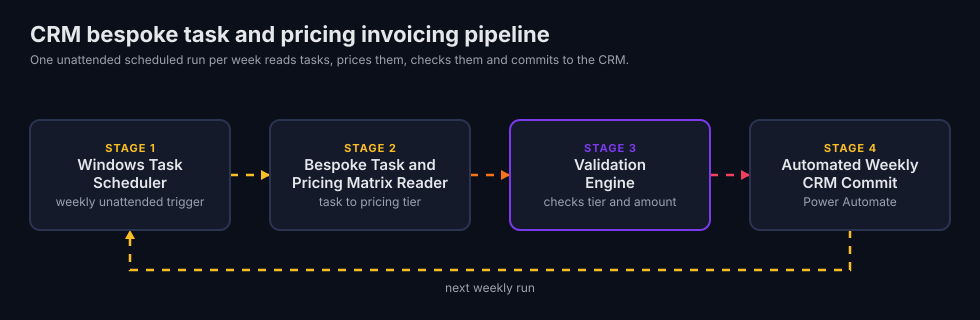

# Automated CRM Bespoke Task and Pricing Invoicing Pipeline

Status: Actively maintained.

This page documents an architectural case study from a live internal deployment. The repository ships no scripts or source code for it.

## Summary

The pipeline reads the bespoke tasks completed each week. It matches each task to a pricing tier and calculates the amount owed. Then it commits the result to the CRM in one unattended scheduled run.

## Architecture

| Stage | Component | What happens |
|---|---|---|
| 1 | Windows Task Scheduler | The scheduler starts the weekly run with nobody at the keyboard. |
| 2 | Bespoke Task and Pricing Matrix Reader | The reader loads the week's bespoke tasks and maps each one to a pricing tier. |
| 3 | Validation Engine | The engine checks each tier and amount against the pricing matrix. |
| 4 | Automated Weekly CRM Commit (Power Automate) | Power Automate writes the validated figures to the CRM. |

## Production evaluation and verification

| Why it was needed (baseline manual bottleneck) | How it is evaluated in production | Measured outcome |
|---|---|---|
| Each week, a person summed bespoke task invoices by hand and typed the totals into the CRM. | The team runs a pricing-tier reconciliation against the matrix each week. | About 1 hour a week of invoice calculation saved. One unattended weekly run replaces the manual sums. |

## Outcome

The pipeline replaces manual weekly invoice sums and CRM data entry with one unattended scheduled run. The Validation Engine sits before the CRM commit, so a pricing mismatch surfaces before any figure reaches the CRM.

## Stack

1. Microsoft Power Automate
2. Windows Task Scheduler
3. CRM automation and unattended RPA
4. Pricing matrix validation
5. Workflow scheduling
