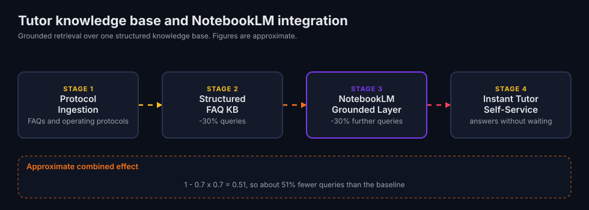

# Conversational Tutor Knowledge Base and NotebookLM Integration

Status: Actively maintained.

This page documents an architectural case study from a live internal deployment. The repository ships no scripts or source code for it.

> This is a Grounded LLM Retrieval and Self-Service Knowledge Architecture. It is not an autonomous multi-agent loop. It appears here because it solves an adjacent operational bottleneck without over-engineering.

## Summary

The project collects tutor FAQs and operating protocols into one structured knowledge base. Google NotebookLM sits on top as a grounded conversational layer. Tutors ask questions in plain language and get answers drawn from the approved sources.

## Architecture



| Stage | Component | What happens |
|---|---|---|
| 1 | Protocol Ingestion | Course teams gather FAQs and operating protocols in one place. |
| 2 | Structured FAQ KB | The material becomes one structured knowledge base with standard entries. |
| 3 | NotebookLM Grounded Layer | NotebookLM answers tutor questions from the knowledge base sources only. |
| 4 | Instant Tutor Self-Service | Tutors find answers without waiting on course leaders, curriculum developers or admin staff. |

## Production evaluation and verification

| Why it was needed (baseline manual bottleneck) | How it is evaluated in production | Measured outcome |
|---|---|---|
| Tutors sent routine questions to course leaders, curriculum developers and admin staff, then waited for replies. | The team measures the query deflection rate from course leader inbox counts. | Roughly 30% fewer queries after the structured KB. Roughly 30% fewer again after the NotebookLM layer. |

## How the two reductions combine

The two reductions multiply. They do not add. Each stage leaves about 70% of the previous query volume.

```text
remaining = 0.7 x 0.7 = 0.49
reduction = 1 - 0.7 x 0.7 = 0.51
```

That gives about 51% fewer queries overall versus the baseline. All three figures are approximate.

## Stack

1. Google NotebookLM
2. Knowledge base architecture and grounded retrieval
3. Protocol standardisation
4. Operational analytics
5. Self-service support
