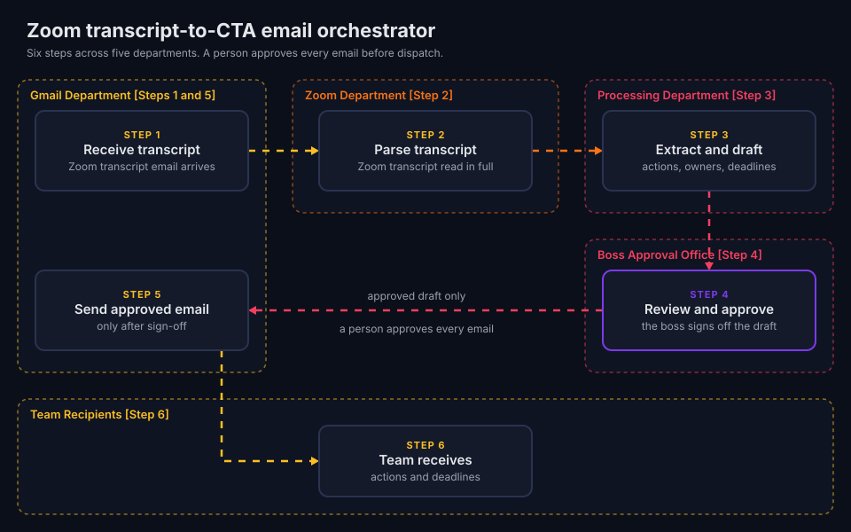

# Autonomous Zoom Transcript-to-CTA Email Orchestrator

Status: Actively maintained.

This page documents an architectural case study from a live internal deployment. The repository ships no scripts or source code for it.

## Summary

The orchestrator watches a work inbox for weekly Zoom transcripts. It drafts a structured summary with calls to action, owners and deadlines. Then it holds the draft for human review. Nothing goes out until a person approves it.

## Architecture

Each department is a zone with one job. The Gmail Department appears twice because it both receives and sends.

| Step | Zone | What happens |
|---|---|---|
| 1 | Gmail Department | The Gmail Department receives the Zoom transcript email. |
| 2 | Zoom Department | The Zoom Department parses the transcript. |
| 3 | Processing Department | The Processing Department extracts actions, owners and deadlines, then drafts the email. |
| 4 | Boss Approval Office | The boss reviews and approves the draft. |
| 5 | Gmail Department | The Gmail Department sends the approved email. |
| 6 | Team Recipients | The team receives the actions and deadlines. |

## Human approval

Step 4 is a hard stop. The workflow pauses until the boss approves the draft. The boss can edit the draft before approval. The Gmail Department sends only the approved version.

## Production evaluation and verification

| Why it was needed (baseline manual bottleneck) | How it is evaluated in production | Measured outcome |
|---|---|---|
| After each weekly meeting, someone wrote the follow-up email by hand. Actions, owners and deadlines came from memory or notes. | A schema validation pass runs on each draft. The reviewer checks action-item extraction recall against the transcript. The team tracks human-in-the-loop edit distance between the draft and the sent email. | About 2 hours a week of email writing saved. A person approves each email before dispatch. |

## Outcome

The orchestrator removes post-meeting admin for the Tasters department. The weekly follow-up arrives in a consistent structure, and a person still owns the final word.

## Stack

1. Agentic orchestration
2. MCP server connectors
3. Gmail API and Zoom transcripts
4. Structured LLM output
5. Human-in-the-loop review
